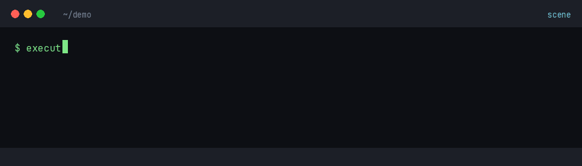

# blender-pipeline

<h3 align="center">Eight specialist Blender playbooks behind one router.</h3>

<p align="center">
  <a href="LICENSE"></a>
  
  
  
</p>

<p align="center">
  
</p>

## What it is

`blender-pipeline` is **one entry point for Blender work driven over MCP**: blockout,
hard-surface, character, materials, lighting, look-dev, render and export. Only the playbook you need is
loaded, and the router carries the prerequisites and the invariants that prevent rework.

## The problem it removes

Eight separate skills cost 383 tokens of description on every session, and ~8k if loaded
together. One router plus on-demand references costs 86 tokens always and one playbook on invoke.

## Install

```bash
# Claude Code — the whole collection as one marketplace
claude plugin marketplace add Appit-labs/appit-skills
claude plugin install blender-pipeline@appit-skills

# pi
pi install git:github.com/Appit-labs/blender-pipeline

# any agent that reads a skills directory
git clone git@github.com:Appit-labs/blender-pipeline.git
cp -r blender-pipeline/skills/blender-pipeline ~/.claude/skills/      # or ~/.codex/skills/, .cursor/skills/, …
```

## Use

- **Model** — `references/modeling.md`
- **Character** — `references/character.md`
- **Shade / light / render** — `references/materials.md`, `lighting.md`, `rendering.md`
- **Ship** — `references/export.md`

## What it does not do

- It is not a substitute for the 94-skill upstream pack; the eight playbooks are the common ones.
- It does not claim an export succeeded without re-importing or reading the exporter report.

## Requires

- Blender 4.2+ (tested on 5.3) running as a GUI process — background mode has no viewport.
- A Blender MCP add-on listening on `127.0.0.1:9876`; check with `get_addon_status`.
- For engine targets, that engine's import convention.

## Cost

| | tokens |
| --- | --- |
| always-on — the description, paid every session | ~86 |
| on invoke | ~1k + one playbook |

The demo above is not a mockup: `demos/blender-pipeline.json` holds the captured run and
`tools/make_demo.py` renders it, so it can be regenerated and audited.

## Security

SkillSpector: **0/100, SAFE, 0 open findings** against the committed baseline. Every accepted
finding is listed with its reason in [SECURITY.md](SECURITY.md). No `shell=True`, no credential
storage, no network destination chosen at runtime.

## Part of the Appit collection

[appit-skills](https://github.com/Appit-labs/appit-skills) — browser QA · CI triage · Postgres · runbooks ·
SSH · Trello · cloud browsers · OpenDesign · Blender.

## License

MIT, copyright Appit Labs. See [LICENSE](LICENSE).

The eight `references/*.md` playbooks are the Blender Skills pack by
[arjun988](https://github.com/arjun988/blender-skills) (MIT); see [NOTICE](NOTICE).
